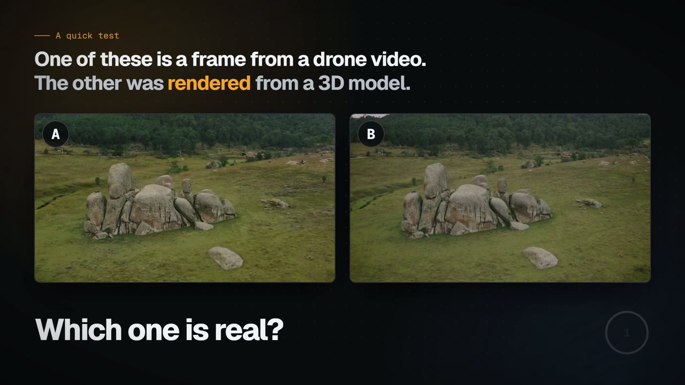
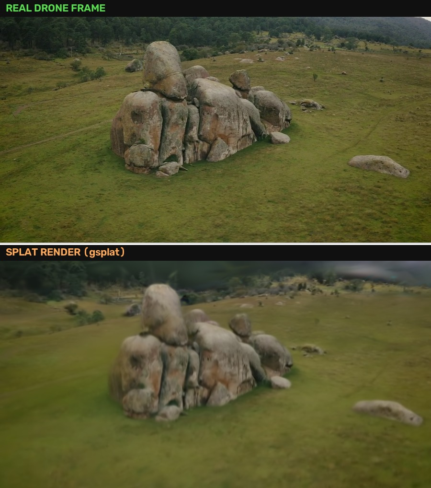
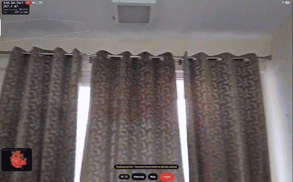
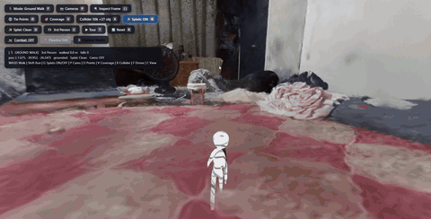
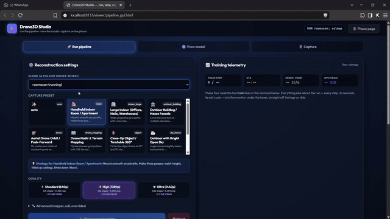
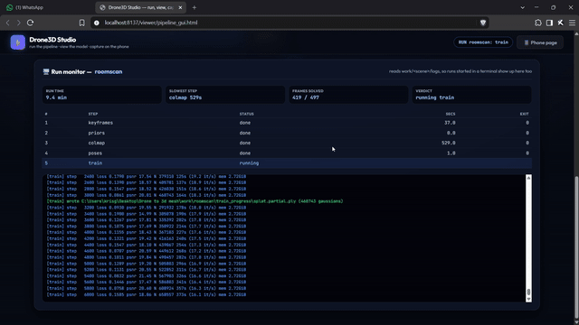

<h1 align="center">Drone / Phone Video → Walkable 3D World</h1>

<p align="center">
  <b>An open-source 3D Gaussian Splatting and photogrammetry pipeline.</b><br/>
  One drone or phone video in. A walkable, physics-backed 3D world out,<br/>
  checked by an automated gate, running in your browser, trained on a 6 GB GPU.
</p>

<p align="center">
  <a href="https://www.youtube.com/watch?v=xMRw3slJjIo" title="Watch the demo on YouTube">
    
  </a>
</p>

<p align="center">
  <b><a href="https://www.youtube.com/watch?v=xMRw3slJjIo">▶ Watch the demo</a></b> ·
  <a href="#quick-start">Quick start</a> ·
  <a href="#measured-not-promised">Measured results</a> ·
  <a href="#how-a-video-becomes-a-world">How it works</a> ·
  <a href="#ground-control-station">Ground Control Station</a> ·
  <a href="#faq">FAQ</a>
</p>

<p align="center">
  <a href="https://github.com/krisgarg25/Drone_Phone_video_to_playable_3d_world/actions/workflows/ci.yml"></a>
  <a href="LICENSE"></a>
  
  
  
  
  <a href="https://github.com/krisgarg25/Drone_Phone_video_to_playable_3d_world/stargazers"></a>
</p>

---

Most video-to-3D pipelines stop at a nice render. A Gaussian splat that looks
photorealistic but has no floor, no scale and no collision is a screensaver.

This project goes the rest of the way. It takes one `.mp4` from a drone or a phone and
runs it through **COLMAP structure-from-motion**, **gsplat 3D Gaussian Splatting**
training, metric scale and gravity recovery, a **voxel collision mesh**, a walkable
ground surface, and an automated **world gate**. Then it proves the result by walking a
character through it headlessly and logging ground contact every half second.

Around that sits a **Next.js Ground Control Station** for measuring, inspecting and
planning on the scan, and a separate **survey lane** that writes georeferenced
deliverables (LAS, GeoTIFF, OBJ, PLY, glTF, FBX).

| | |
|---|---|
| **Input** | One video (`.mp4` `.mov` `.webm` `.mkv` …) or several clips of the same place. Optional phone AR pose logs. |
| **Output** | Gaussian splat (`.ply`), collision mesh (`.glb`), ground heightfield, navmesh, camera poses, a generated tour route, blinded A/B evidence. |
| **Viewer** | PlayCanvas in the browser: third-person walk, drone fly, first person, VR. |
| **Hardware** | NVIDIA GPU with CUDA 12.4. Developed and measured on an RTX 3050 6 GB laptop. |
| **Tuning** | `--preset auto` diagnoses the footage. Training budgets are sized from the VRAM free at that moment. |
| **Platform** | Windows 10/11 (COLMAP and ffmpeg are vendored as `.exe`). |

## Measured, not promised

Every number below was read from a run's own logs on disk, and each row names the file.
Where a result has a caveat, the caveat is in the table.

**Drone scene: one 12 second clip (1280×720) on an RTX 3050 6 GB, `--quality high`**

| Stage | Result | Source |
|---|---|---|
| Keyframes | 72 selected automatically | `logs/01-keyframes.log` |
| Camera solve (COLMAP) | **72 / 72 registered**, first attempt | `logs/02-colmap.log` |
| Gaussian budget | 3,000,000 requested → **1,115,861** allowed by 5.0 GiB free VRAM | `logs/04-train.log` |
| Training (gsplat) | 15,000 steps in **13 min 38 s**, training PSNR 41.57 dB | `logs/04-train.log` |
| Model | 232,940 Gaussians trained, 129,211 shipped to the browser | `splat.ply`, `scene.ply` |
| World gate | 14 checks: **13 pass, 1 not applicable**, 0 hard failures | `world_check.json` |
| Whole run | **18 min 16 s**, 17 steps | `report.json` |
| Walk test | **65.4 m walked, 0 falls**; 12 of 71 samples airborne | `walktest/walk_log.json` |

> **Caveat, stated plainly.** In that 18-minute run the walk-test step itself crashed on a
> viewer script error, so the run is recorded as `partial`. The 65.4 m walk log comes from
> re-running the walk test the next day against the same build.

**Phone scene: a 139 second handheld room scan with AR pose priors**

| Stage | Result |
|---|---|
| Camera solve | 480 of 487 keyframes registered (98.6%) |
| Model | 486,474 Gaussians trained, 357,247 shipped |
| World gate | 13 pass, 1 not applicable |
| Walk test | 9.6 m walked inside the room, 0 falls, 0 of 331 samples airborne |

### Can you tell which one is real?

Top: a frame from the drone video. Bottom: the splat, rendered from the same camera.
Ten of these stacks are generated per scene with the labels hidden, and the answer key
is kept in a separate file ([`results/`](results/)).

<p align="center">
  
</p>

## See it running

Screen recordings of the actual tools. No mock-ups.

<table>
  <tr>
    <td width="50%" align="center">
      <br/>
      <sub><b>Phone capture.</b> Live coverage gauge and angle cues, served to the phone over HTTPS.</sub>
    </td>
    <td width="50%" align="center">
      <br/>
      <sub><b>The result.</b> Walking the reconstructed boulder field on its collision mesh.</sub>
    </td>
  </tr>
  <tr>
    <td align="center">
      <br/>
      <sub><b>One-click run.</b> Scene, capture preset and quality tier.</sub>
    </td>
    <td align="center">
      <br/>
      <sub><b>Live monitor.</b> Camera solves, loss curve and Gaussian count, read from the run's logs.</sub>
    </td>
  </tr>
</table>

## Quick start

**You need:** Windows 10/11, an NVIDIA GPU, Python 3.12 and 3.10, Node 18+, Git with Git LFS.

```bash
git clone https://github.com/krisgarg25/Drone_Phone_video_to_playable_3d_world.git
cd Drone_Phone_video_to_playable_3d_world
git lfs pull
```

> Do not skip `git lfs pull`. COLMAP's 313 MB CUDA provider is stored in LFS, and without
> it COLMAP exits with a stack buffer overrun.

```bash
python scripts/bootstrap.py --with-train
```

This creates `.venv` (Python 3.12, the pipeline) and `.venv310` (Python 3.10, PyTorch +
gsplat for CUDA 12.4), installs the Node collider tool and downloads Chromium for the
walk test. Then check the toolchain:

```bat
.venv\Scripts\python.exe pipeline.py doctor
```

Put a video at `videos\myscene\clip.mp4` and run:

```bat
.venv\Scripts\python.exe pipeline.py run myscene
```

```bat
.venv\Scripts\python.exe pipeline.py view myscene
```

| Command | What it does |
|---|---|
| `pipeline.py run <scene>` | Full pipeline. Resumable: a step re-runs only if its inputs changed. |
| `pipeline.py run <scene> --quality smoke` | Every step on the real reconstruction, in minutes. For shakedowns. |
| `pipeline.py scan <scene>` | Diagnose footage without reconstructing. |
| `pipeline.py status <scene>` | Per-step completion state. |
| `pipeline.py view <scene>` | Serve and open the walkable viewer. |
| `pipeline.py mobile` | Serve the phone capture page over HTTPS and print its link. |
| `pipeline.py doctor` | Toolchain health check with a fix for each problem found. |
| `mvp.bat` | Open the dashboard: run, view and capture from one page. |

Quality tiers: `smoke` (300 steps), `standard` (12k), `high` (15k, default), `ultra` (45k, for 8 GB+).
Capture presets: `auto`, `room`, `indoor_large`, `outdoor_building`, `drone`,
`drone_mapping`, `object`, `sky_heavy`, `corridor`.

## How a video becomes a world

```mermaid
flowchart LR
    A["<b>Video</b><br/>drone or phone"] --> B["<b>Keyframes</b><br/>sharpness, overlap"]
    B --> C["<b>COLMAP SfM</b><br/>camera poses"]
    C --> D["<b>gsplat training</b><br/>VRAM-sized budget"]
    D --> E["<b>World frame</b><br/>gravity, metric scale"]
    E --> F["<b>Collider</b><br/>voxel shell, ground"]
    F --> G["<b>World gate</b><br/>14 checks"]
    G --> H["<b>Walk test</b><br/>headless autopilot"]
    H --> I["<b>Browser viewer</b><br/>walk, fly, VR"]
```



Four problems a render-only pipeline never has to solve:

1. **Reconstructions have no scale.** Structure-from-motion recovers a scene up to an
   unknown factor. Scale here comes from a physical ruler: GPS telemetry when the flight
   has it, otherwise how fast the camera moved (`--speed-anchor`, a drone flies about
   5 m/s) or how high it was held (`--height-anchor`, a walked phone is about 1.6 m). A
   monocular depth model then checks that ruler independently and reports disagreement
   instead of quietly rewriting it.
2. **Splats are not colliders.** Gaussians have no surfaces. The pipeline voxelises the
   splat into a collision shell, builds two candidate ground surfaces, routes on both, and
   ships the one the autopilot walks further on.
3. **VRAM is not a setting.** Training reads the free GPU memory at that moment and sizes
   its frame resolution and Gaussian cap to fit, so a 6 GB card finishes instead of
   running out of memory.
4. **"It walked 65 m" means nothing if the character was floating.** Every build can be
   walked headlessly, with ground contact sampled every 0.5 s and falls counted.

<details>
<summary><b>All 26 pipeline steps</b></summary>

<br/>

Steps marked *conditional* only run when the footage calls for them. Steps marked
*advisory* can fail without failing the run.

| # | Step | What it does |
|---|---|---|
| 1 | `keyframes` | Extract sharpness-filtered keyframes from one or more clips. |
| 2 | `frames` | *Conditional.* Flatten illumination in a copy used only for matching. |
| 3 | `priors` | *Conditional.* Turn a phone AR pose log into COLMAP pose priors. |
| 4 | `colmap` | Plan-driven structure-from-motion with a ladder of rescue strategies. |
| 5 | `poses` | Parse the COLMAP model into per-keyframe poses. |
| 6 | `dynamics` | Mask moving objects; keep the result only if more frames register. |
| 7 | `train` | 3D Gaussian Splatting training (gsplat, CUDA). |
| 8 | `frame` | Solve the world frame: gravity direction and metric scale. |
| 9 | `depth` | *Advisory.* Monocular metric depth as an independent second ruler. |
| 10 | `export` | Write viewer assets in final coordinates. |
| 11–13 | `sky`, `clouds`, `reexport` | *Conditional.* Cull sky and cloud fill on outdoor scenes. |
| 14 | `colors` | Colour the ground from the splat. |
| 15 | `collider` | Voxel collision mesh via `@playcanvas/splat-transform`. |
| 16 | `objects` | Box colliders for things standing on the floor. |
| 17 | `surface` | Build both candidate grounds and ship the one that walks better. |
| 18 | `nav` | *Advisory.* Bake a navigation mesh. |
| 19 | `semantics` | *Advisory.* Label ground, road, building, vegetation, obstacle. |
| 20 | `rooms` | *Advisory.* Detect floor, ceiling and walls in interiors. |
| 21 | `texture` | *Advisory.* Bake the video frames into a UV texture. |
| 22 | `gate` | The world gate: is it the right way up, and can you stand on it? |
| 23 | `audit` | *Advisory.* Compare the finished world with the preset it was built as. |
| 24 | `evals` | *Advisory.* Render the splat offline at evaluation poses. |
| 25 | `pairs` | *Advisory.* Compose blinded real-vs-render A/B stacks. |
| 26 | `walktest` | Drive the viewer headlessly and log the walk. |

Every step appends to `work/<scene>/logs/<nn>-<step>.log`.

</details>

## Record on a phone or a drone

One continuous take, slow and steady.

- **Arcs and orbits, never pans.** Step sideways while you turn. A pure rotation gives
  structure-from-motion nothing to triangulate.
- **Three passes at different heights** for anything with vertical surfaces.
- **Overlap generously** between consecutive views, and circle each corner.

To record with pose priors from the phone itself:

```bat
.venv\Scripts\python.exe pipeline.py mobile
```

Open the HTTPS link it prints on a phone on the same Wi-Fi. The page shows live coverage
while you scan. Full guide: [docs/PHONE_CAPTURE.md](docs/PHONE_CAPTURE.md).

## Ground Control Station

[`groundcontrol/`](groundcontrol/) is a Next.js 16 + React 19 + Tailwind CSS v4 console
over the reconstruction backend. It follows one design rule: every reading comes from
the backend, and a value the server did not report is shown as "not evaluated", never
as a plausible number.

```bash
# terminal 1: the backend
.venv\Scripts\python.exe _serve.py 8137 .

# terminal 2: the console, at http://localhost:3000
cd groundcontrol
npm install
npm run dev
```

Each scanned scene opens in a workspace with nine modes:

| Mode | What you do there |
|---|---|
| **Explore** | Inspect the splat, point cloud, mesh, orthomosaic and elevation layers. |
| **Measure** | Distance, area, stockpile volume, cut and fill, cross-sections. |
| **Inspect** | Crack candidates, tilt, wire sag, cloud-to-cloud change. Click a defect to see every source frame that saw it. |
| **Operations** | First map during the flight, change detection, damage grading, debris volume, flood and access routing. |
| **Twin** | Compare epochs, keep an inventory, export CityJSON and 3D Tiles. |
| **Plan** | Draw a proposal on the scan, check setback rules, run a shadow study. |
| **Mission** | MGRS coordinates, line of sight, viewsheds, route exposure, landing-zone checks, rehearsal with an after-action review. |
| **Place** | Stage furniture and equipment on the scanned floor. |
| **Walk** | Third-person walk over the verified collision surface. |

### Eight application profiles

The scan is the same; the analyses, products and acceptance checks change with what it
is for. Profiles are defined once in [`scripts/applications.py`](scripts/applications.py)
and selected with `--application`.

| Profile | Typical questions |
|---|---|
| **Military reconnaissance** | Where is that, in MGRS? What can be seen from here? How exposed is this route? |
| **Urban planning** | How tall are these buildings? Does this proposal break a setback? What does it shade? |
| **Disaster assessment** | What changed? How much debris? Which roads are blocked? |
| **Construction monitoring** | How big is that stockpile? Cut and fill against the design surface? |
| **Border and corridor mapping** | What changed along the line, and where are the blind spots between posts? |
| **Infrastructure inspection** | Is the pylon leaning? How much sag? Which frames show this crack? |
| **Archaeology and heritage** | Cross-sections, hillshade, and an archive record of how the scan was made. |
| **Digital twins** | Layered visual, geometric and evidence views, packaged for other engines. |

Requirements for each are written up in
[docs/APPLICATION_PLAYBOOKS.md](docs/APPLICATION_PLAYBOOKS.md).

## Two lanes in one repository

They share capture and structure-from-motion, and produce different things. Their
numbers should not be mixed.

| | **Splat lane** | **Survey lane** |
|---|---|---|
| Entry point | `pipeline.py run <scene>` | `survey.py prepare / reconstruct / align / evaluate <scene>` |
| Produces | Gaussian splat, collision mesh, walkable viewer | Dense cloud, mesh, georeferenced deliverables |
| Formats | `.ply` splat, `.glb` collider | LAS, GeoTIFF, OBJ, PLY, glTF, FBX |
| Judged by | World gate, walk test, blinded A/B | Checkpoint error against surveyed truth |
| Status | Measured on real footage (above) | Implemented and unit-tested. **Metric accuracy against surveyed checkpoints has not been measured yet.** |

`ops.py` adds analyses on measured clouds: change detection, volumes, cut and fill
against a design surface, damage grading, corridor products and tiling.

## Viewer controls

| Key | Action | Key | Action |
|---|---|---|---|
| `W` `A` `S` `D` | Walk, or fly in drone mode | `F` | Toggle drone flight / ground walk |
| `Shift` | Run | `C` | Toggle first / third person |
| `G` | Gaussian splats on / off | `X` | Collision mesh wireframe |
| `P` | COLMAP camera frustums | `O` | Sparse tie points |
| `V` | Coverage overlay | `T` | Play the generated tour |
| `[` `]` | Step through source frames | `R` | Reset to spawn |

## Repository layout

```text
pipeline.py          Splat lane: the step graph, presets, VRAM budgeting
survey.py            Survey lane: prepare, reconstruct, align, evaluate
ops.py               Change, volume, cut/fill, damage, corridor, tiles
_serve.py            Local server: HTTP :8137, HTTPS :8138 for phone capture
mobile.py            One-command phone capture launcher
scripts/             116 Python modules: SfM, training, colliders, survey, analysis
viewer/              PlayCanvas walkable viewer and the phone capture page
groundcontrol/       Next.js 16 Ground Control Station
tests/               64 fast suites, browser checks and the end-to-end run
tools/               Vendored COLMAP, ffmpeg, splat-transform, navmesh baker
docs/                Capture guide, application playbooks, readiness evidence
results/             Blinded A/B stacks, texture comparisons, critic verdicts
video_production/    How the demo film was made
```

## Tests and CI

```bat
.venv\Scripts\python.exe tests\check_all.py
```

64 fast suites with more than 1,000 test functions cover the scenario engine, capture
diagnostics, the collider, the world gate and the survey modules. None of them need a
GPU. CI runs them on Windows on every push, because Windows is the platform people
actually run this on.

CI cannot prove anything that needs an NVIDIA GPU, the vendored COLMAP binary or a real
reconstruction. That is `python tests/test_e2e.py`, run locally against your own takes.

## Status and limitations

- **Windows only.** COLMAP and ffmpeg are vendored as Windows binaries.
- **NVIDIA only.** Training needs CUDA. Everything before and after it runs on CPU.
- **Scale is a ruler, not a survey.** Without GPS telemetry or pose priors the metric
  scale rests on an assumed flight speed or camera height.
- **Survey accuracy is unproven.** The georeferencing and evaluation code is tested on
  synthetic data. No flight with surveyed checkpoints has been run through it yet.
- **Two builds on disk.** The measured results above come from the two scene builds whose
  logs are kept. Earlier benchmark scenes were pruned and are not quoted here.

What is built, what is only tested, and what is still open is tracked line by line in
[docs/GAPS_AND_OPTIMIZATIONS.md](docs/GAPS_AND_OPTIMIZATIONS.md) and
[docs/readiness/](docs/readiness/00-INDEX.md).

## FAQ

<details>
<summary><b>Can I turn a drone video into a 3D model with this?</b></summary>

Yes. Put the video in `videos/<scene>/` and run `pipeline.py run <scene>`. You get a
Gaussian splat and a collision mesh you can walk on in the browser. For georeferenced
survey products such as LAS or GeoTIFF, use the survey lane with the flight's telemetry.
</details>

<details>
<summary><b>How much VRAM does 3D Gaussian Splatting need here?</b></summary>

It was developed on 6 GB. Training measures free VRAM and sizes its own budget, so a
smaller card trains a smaller model instead of failing. In the measured drone run the
trainer reported 1.67 GiB in use.
</details>

<details>
<summary><b>Does it work with an iPhone or Android video?</b></summary>

Yes. Any video works. The built-in capture page can also record AR pose priors, which
help COLMAP register footage that plain structure-from-motion gives up on.
</details>

<details>
<summary><b>Does it run on Linux or macOS?</b></summary>

Not today. The vendored COLMAP and ffmpeg builds and the pinned gsplat wheel are for
Windows x86-64.
</details>

<details>
<summary><b>Can I use the result in Unity, Unreal Engine or Blender?</b></summary>

The splat is a standard `.ply` and the collider is a standard `.glb`, so anything that
reads those formats can load them. The survey lane also writes OBJ, FBX and glTF meshes.
</details>

<details>
<summary><b>How is this different from nerfstudio or OpenDroneMap?</b></summary>

Those are excellent at what they do: nerfstudio for training and research on radiance
fields, OpenDroneMap for aerial survey products. This project's focus is the step after
reconstruction: giving the result gravity, scale, collision and a walkable surface, and
verifying that automatically. It builds on the same foundations (COLMAP and gsplat).
</details>

<details>
<summary><b>Do I need ground control points?</b></summary>

Not for a walkable world. For survey-grade accuracy you would, and that path has not
been validated yet (see Status and limitations).
</details>

## Troubleshooting

| Symptom | Fix |
|---|---|
| COLMAP exits with `stack buffer overrun` / `0xC0000409` | The LFS file is still a pointer. Run `git lfs install` then `git lfs pull`. |
| Warnings about spaces in the path | Clone to a path without spaces, such as `C:\Projects\Drone3D`. |
| `splat-transform not installed` | Run `npm install` inside `tools/`, or re-run `scripts/bootstrap.py`. |
| Port 8137 already in use | Another `_serve.py` is running. Stop it, or pass a different port. |
| `train` reports no CUDA | Re-run `python scripts/bootstrap.py --with-train` and check `nvidia-smi`. |
| The phone cannot open the capture page | Use the `https://` link, accept the self-signed certificate warning, and keep both devices on the same network. |

`pipeline.py doctor` checks all of these and names the fix.

## Contributing

Bug reports, capture footage that breaks the pipeline, and pull requests are welcome.
Start with [CONTRIBUTING.md](CONTRIBUTING.md). Security reports go through
[SECURITY.md](SECURITY.md).

## Citation

If this is useful in your research, the **Cite this repository** button in the sidebar
gives you BibTeX and APA, generated from [CITATION.cff](CITATION.cff).

## License and acknowledgements

MIT. See [LICENSE](LICENSE).

Built on the work of:

- [COLMAP](https://colmap.github.io/): structure-from-motion and multi-view stereo (BSD-3-Clause)
- [gsplat](https://github.com/nerfstudio-project/gsplat): CUDA Gaussian Splatting rasterisation (Apache-2.0)
- [PlayCanvas](https://github.com/playcanvas/engine) and [splat-transform](https://github.com/playcanvas/splat-transform): the web engine and the collider voxeliser (MIT)
- [3D Gaussian Splatting for Real-Time Radiance Field Rendering](https://repo-sam.inria.fr/fungraph/3d-gaussian-splatting/), Kerbl, Kopanas, Leimkühler and Drettakis, 2023
- [Next.js](https://nextjs.org/), [React](https://react.dev/) and [FFmpeg](https://ffmpeg.org/)

<p align="center">
  <sub>If this saved you time, a star helps other people find it.</sub>
</p>
